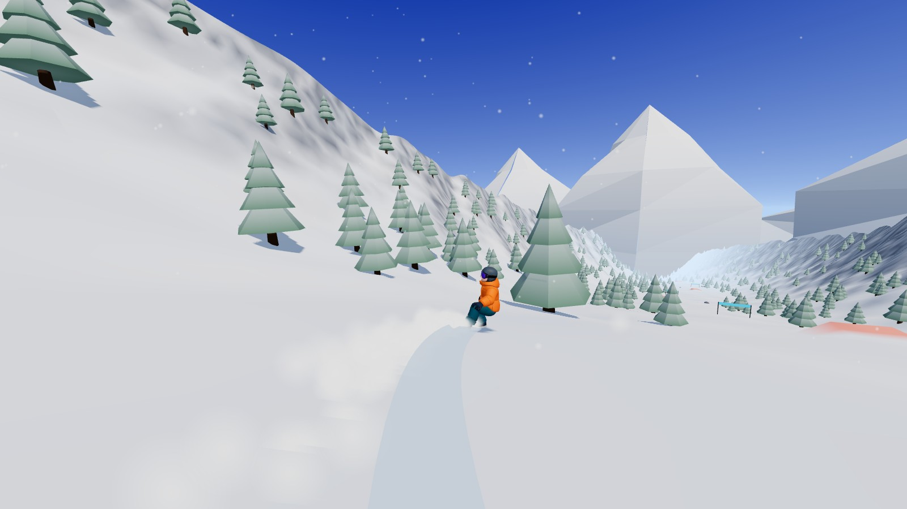
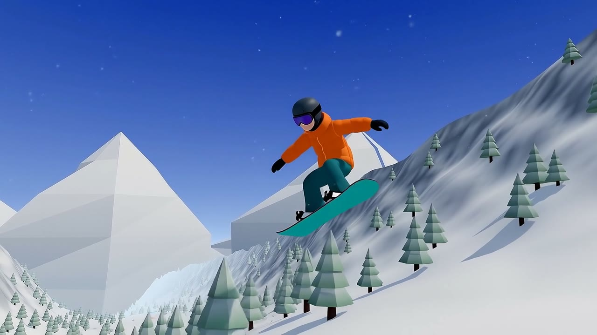
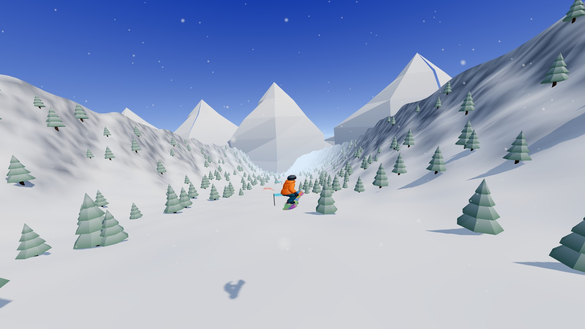
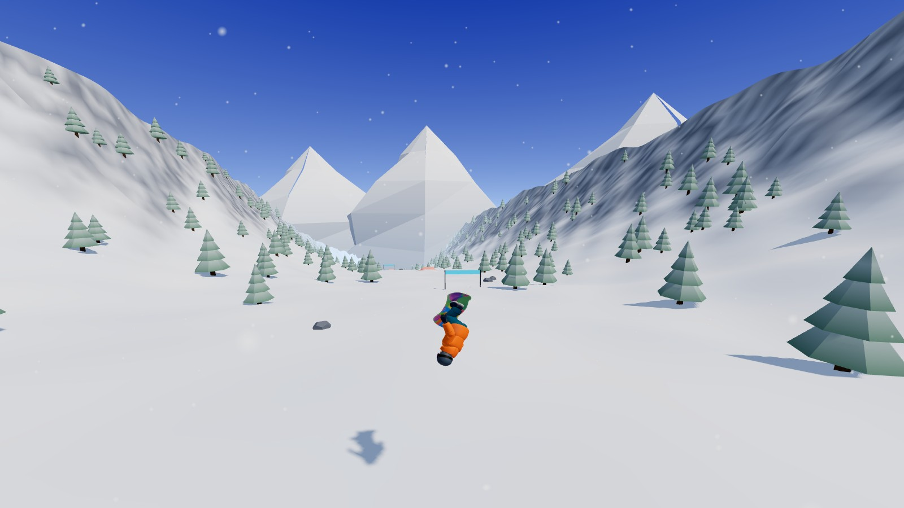

# 粉雪狂飆 POWDER RUSH

單板滑雪 3D 網頁動作遊戲。從 3,200 公尺的山頂一路衝到終點，飛越跳台、做轉體 / 空翻 / 抓板、穿過旗門拿下最高分。



**線上遊玩：** https://malilion.github.io/Snowboarding/

## 宣傳影片

[](https://malilion.github.io/Snowboarding/promo.mp4)

▶ [觀看 28 秒宣傳影片](https://malilion.github.io/Snowboarding/promo.mp4)（以遊戲畫面為起始影格，用 Google Flow 的 Veo 3.1 生成）

## 特色

- **一條完整的下坡賽道**：3,200 公尺蜿蜒雪道，18 個跳台、旗門、樹木與岩石
- **花式系統**：轉體、前 / 後空翻、抓板可以自由組合，連續成功會累積連段倍率
- **落地判定**：板子沒對正或空翻沒轉完就會摔倒扣分
- **不需安裝**：瀏覽器直接玩，支援鍵盤與觸控

| 跳台轉體 + 抓板 | 後空翻 |
| --- | --- |
|  |  |

## 操作

| 按鍵 | 地面 | 空中 |
| --- | --- | --- |
| A / D、← / → | 轉彎 | 轉體 |
| W、↑ | 蹲低加速 | 前空翻 |
| S、↓ | 煞車 | 後空翻 |
| Space | 按住蓄力、放開起跳 | — |
| Shift / E | — | 抓板 |

R 重來、P 暫停、M 靜音。觸控裝置會顯示螢幕按鈕。

## 計分

| 項目 | 分數 |
| --- | --- |
| 轉體 | 每 180° 起跳 120 分，轉越多加成越高 |
| 空翻 | 每周 450 分起 |
| 抓板 | 80 分 + 抓越久越多 |
| 組合 | 兩種 ×1.5、三種 ×2.2，連段每次再 +25% |
| 旗門 | 每個 250 分並小幅加速 |
| 時間獎勵 | 170 秒內完賽，每快 1 秒 +30 分 |
| 摔倒 | −150 分，連段歸零 |

## 本機執行

```bash
npm install
npm run dev
```

打包靜態檔：

```bash
npm run build
```

推到 `main` 會由 GitHub Actions 自動打包並部署到 GitHub Pages。

## 技術

Three.js + Vite，沒有使用物理引擎或外部音效檔。

- `src/terrain.js`：解析式高度場（賽道、跳台、旗門）、分塊地形網格、樹木與岩石
- `src/main.js`：滑行物理、花式判定與計分、相機、HUD
- `src/rider.js`：滑雪者模型載入；模型不存在時改用程序化角色
- `src/effects.js`：雪霧、板痕、飄雪
- `src/audio.js`：WebAudio 程序化音效

滑雪者模型（`public/models/rider.glb`）以 Hyper3D Rodin 生成並綁定骨架，姿勢由程式即時驅動。宣傳影片以 Google Flow 生成。
